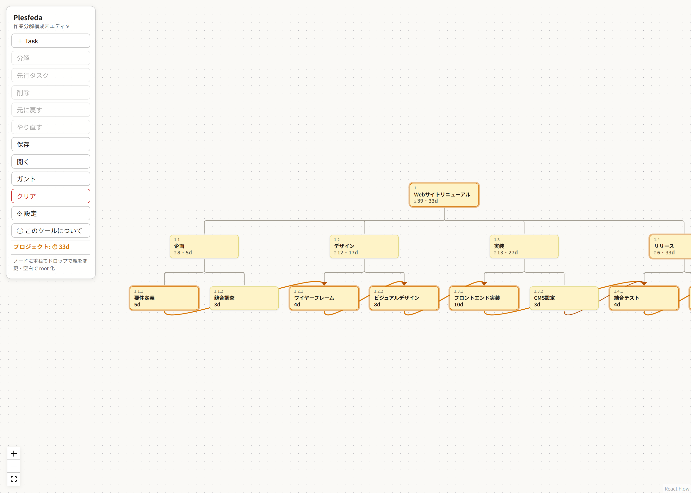

# Plesfeda（プレスフェダ）

**[Live demo](https://cuculhart.github.io/plesfeda/)** — インストール不要・ブラウザだけで動きます



**本物の WBS を組み立てるためのボード** — まず分解、日程はあと。

世に「WBSツール」と呼ばれるものの多くは、実際にはガントチャート作成ツールです。
Plesfeda が扱うのは WBS そのもの、すなわち **work を breakdown した structure** です。
主役は **分解（breakdown）** と **階層構造（structure）** であり、依存関係・
スケジュール・ガントチャートはすべて派生的な出力にすぎません。

**Plesfeda はプロジェクトマネジメントの道具ではありません。** このボリュームの
開発が、はたして納期内に収まるのかを冷静にジャッジするための道具です。
work を分解し、葉に工数を置けば、構造がコストと最早完了を返します。

MS Project や OpenProj / LibrePlan といった本格PMツールは、行単位の移動は
できても工程ブロックを構造ごと自由に付け替えることはできず、日本の祝日
カレンダーも内蔵されていない。そんな理由で挫折し、結局 Excel に戻った
経験がありませんか？Plesfeda は、そうした痒いところに
手が届くことを目指しています。subtree ごとのドラッグ付け替え、休暇や
作業時間の自由な設定、完全ローカルの JSON 保存。

English: [README.md](README.md)

## コンセプト

無限キャンバスのボード上に **ノード** を置き、線で結んで木を組み立てます。

- **Task ノード** — WBS の1要素（ワークパッケージ / 作業項目）。
  タスク名と所要工数を一体で表示します。
- **Connect 線** — 親→子の breakdown 関係を表す接続線。
  ノードと線の集合が、ボード上に木（森）として描画されます。
- **ガントは出力のみ** — ツリーから生成される読み取り専用レポートです。
  入力はすべてツリー上で行います。

## Breakdown 入力

このツールの中核。「分解する」という思考操作をそのまま連続入力できるUIです。

1. ボード上に `[task]` を作成する。
2. プロパティで **breakdown** を選択 → 点線囲いの `[child]` が2つ現れる:
   - 1つ目 — **アクティブな入力用**。カーソルが入り、すぐ入力できる。
   - 2つ目 — **ゴースト**。次の入力枠の予告。
3. 1つ目を確定 → 2つ目がアクティブになり、3つ目がゴーストで現れる。
4. 途中で中断すると、アクティブ枠はゴーストに戻って親の末尾に残る。
   戻ってきてゴーストをアクティブ化すれば、アクティブ＋ゴーストの2枠で再開できる。

ゴーストは確定するまで実体化せず、データには載りません。

## 構造ルール

- **深さで揃う。** 同じ深さのノードは、親が違っても同じ縦位置（レベル帯）に並びます。
- **複数 root。** ボード上は森になりえます。後から新しい parent を追加して、
  既存の root をまとめてその子にすることもできます（ボトムアップな構造化）。
- **自在な付け替え。** subtree ごと別の親へ移動できます。元の子孫の下へ移すことも可能です。
  循環は常に拒否されます。
- **親を削除するときは選択式:** 直下の子を独立した root に昇格させるか、subtree ごと削除するか。
- **複数選択＋一括削除。** Shift+クリックの追加選択・Shift+ドラッグの範囲選択が
  使えます。散在する葉だけを、親を残したまままとめて消せます
  （選択に親が混ざるときは従来どおり確認モーダルが出ます）。
- 分岐数は作法上の上限ではなく、変数 `MAX_CHILDREN` として定義します。
- **WBS № は派生表示。** 位置から `1.2.3` 形式の番号を自動採番します。
  付け替え・並べ替えで自動的に振り直され、データには持ちません。

## 所要工数

- 各タスクは工数の数値を持ちます。0 は非表示。数値欄をクリックして入力します。
- **ロールアップ:** 葉ノードは手入力。子を持つノードには subtree の再帰合計が
  自動表示されます。つまり root を見れば構造全体の工数が分かります。

## 依存関係とスケジュール（PERT/CPM）

- タスクは先行タスクを宣言できます（finish-to-start）。タスクを選択して
  **先行タスク** ボタンを押し、先行するタスクをクリックします。
- 親の完了は配下すべての完了を意味するので、親への依存は subtree 全体を待ちます。
- 葉の最早開始 = max(親の開始, 先行タスクの完了)。最早完了 = 開始 + 工数。
  親の工期は子孫の最早完了なので、依存のない子は並列、依存のある兄弟は直列になります。
- 親ノードは **合計工数（Σ）と最早完了までの工期** を両方表示します。
- ツールバーにプロジェクトの最早完了を表示し、**クリティカルパス**を
  ノードと依存線で強調します。
- 依存の循環や祖先・子孫への依存はエラー表示され、解消するまでガント出力はブロックされます。

## ガント出力

スケジュールから生成される読み取り専用レポート。基準日・土日・休暇を考慮した
簡易カレンダー、CP 強調、マイルストーン表示に対応し、印刷は縦横2次元の
ページ分割（各ページにヘッダ反復＋ページ番号）で帳票として出力できます。

## エクスポート

Export ダイアログは計算済みのスケジュールを帳票として引き渡します。
日付は焼き付け済みなので、受け取り側に Plesfeda のカレンダーは不要です。

- **TSV コピー／CSV 保存**（UTF-8 BOM付き）— Google Sheets・Excel・表への
  貼り付け。WBS番号・階層・工数ロールアップ・開始/終了・先行・
  クリティカルフラグを出力。末尾に実績入力用の空列
  （Assignee/Status/Progress/ActualStart/ActualFinish）を持つので、
  貼り付けたシートがそのまま進捗トラッキングに使えます
- **課題管理ツール一括登録用 TSV** — 課題管理ツールの一括登録画面に
  そのまま貼れる形式（件名・開始日・期限日・予定時間）
- **Mermaid `gantt`** — GitHub・Notion・ドキュメントに埋め込み。
  section・`after` 依存・`crit`・`milestone` を出力

## 多言語対応

英語ファースト。UI の文字列はソースに英語で書き、各ロケールは
英語ソース文字列をキーとする翻訳テーブル（`src/i18n.ts`）です。
未訳の文字列は英語にフォールバックするので、言語追加はテーブルを拡張するだけです。

## 技術スタック

React + TypeScript + Vite + [@xyflow/react](https://github.com/xyflow/xyflow)。
完全ローカル: ブラウザストレージと JSON ファイルのエクスポート/インポートのみ。
外部送信はありません。

```bash
npm install
npm run dev
npm run build
```

## 名前について

**Plesfeda** = ウェールズ語 *pleth*（編む／組み紐）+ 古アイルランド語 *feda*
（「木々」— 消えたケルト文字・オガムの字母の総称でもある。各文字は樹木の名を持つ）。
「木々を編んだ構造」。

## License

MIT
